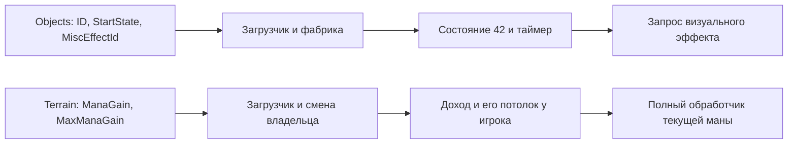

# Mana Vault: создание, периодический эффект и доход

Продолжение этапа112: [VAULT_MAP_RU.md](VAULT_MAP_RU.md) / `vault-map-semantics.json`. Теперь7 полных цепочек44FC40→mana исполняются в однойCPU-памяти, включая6 замен старого Vault; два случая сверены вGhidra. Старому Object ставится HP0, затем создаётся новый; мгновенное удаление не доказано. Старые схемы и ограничения этапа111 ниже сохранены как история; смысл ManaGen по-прежнему не установлен.

Этап111, 29 октября2026. Профиль — предоставленный `DKII-DX.exe`, SHA-256 `d7a8b854e4e4f02709eba271bead6fe2307dd6e332b5a96e70857e5b0e19fb8a`. Машинная схема — `vault-runtime-semantics.json`, компонент `vault_runtime_semantics`.

**Фактическая фабрика Mana Vault включает состояние42.** Разобранное на этапе110 состояние39 имеет справочное имя `MANA_VAULT` и другой периодический обработчик; его название не устанавливает состояние, которое получает объект при нормальном создании. Теперь проверена полная загрузка сырой записи и настоящая фабрика, без ручного назначения активного состояния.

Подтверждены две самостоятельные цепочки:

## Что делает конструктор Object

Обычная инициализация `49B1C0` сразу копирует BYTE definition`+11B` / raw`+35B` в активный DWORD экземпляра`+13A`, обнуляя возраст`+13E`. Поэтому только что созданный объект может вызвать свой обработчик уже при первом обновлении. Отложенное копирование, проверенное на этапе110, относится к ситуации, когда экземпляр ещё находится в состоянии0.

В конце инициализации есть отдельная таблица по ID. Ровно **101,108,114** попадают в ветку `49B512`: оригинальный setter `49EF60(42)` ставит состояние42 и возраст0, после чего DWORD экземпляра`+14A` получает `2*TicksPerSecond`. Это перекрывает StartState из файла. Полная фабрика подтвердила перекрытие даже исходных значений59 и255 для соответствующих типов.

Встроенная диагностика `49D310` называет DWORD`+14A` **EffectTriggerRepeatTimer**. Подпись по адресу`69DE84` и таблицы конструктора сверены с исходными байтами EXE. Период копируется при создании; сам обработчик42 не пересчитывает его из текущего TPS при каждом вызове. Это поле экземпляра, а не дополнительное поле 894-байтовой записи Objects.

| Object ID текущего файла | Имя | StartState в файле | Состояние после фабрики | MiscEffectId |
|---:|---|---:|---:|---:|
|101|Mana Vault|0|42|287|
|108|Claimed Mana Vault|0|42|288|
|114|Hero Gate [ 2 By 2 ]|0|42|310|

При TPS20 период равен40 обновлениям возраста. Проверены39 обновлений без запроса,40 с одним запросом,80 с двумя; TPS10 даёт период20. Звук в стенде возвращает нулевые handles, графическая модель отсутствует.

## Обработчик42 и ограничения StartState

`4A3530` выбирает период и **WORD raw Objects`+358` → definition`+117`**, MiscEffectId, только для ID101/108/114. После увеличения возраста выполняется unsigned-деление на период; при нулевом остатке формируется запрос эффекта.

Правка MiscEffectId на123 передала123 в настоящий мост. Значение0 **тоже передаётся**: локальной проверки ненулевого ID в этом обработчике нет. Это отличается от обработчика состояния40. Проверен сам запрос, а не обработка ID0 настоящим renderer.

Для другого Object ID регистр делителя остаётся нулевым. Сырая запись обычного Door Key17 со StartState42 прошла загрузчик и фабрику, после чего первый полный Object tick остановился на оригинальном **`DIV ECX` по `4A3568`, ECX=0**, с `UC_ERR_EXCEPTION`. Здесь воспроизведена процессорная ошибка в изолированной CPU, не краш запущенной Windows-игры.

Следовательно, наличие состояния в таблице0–58 ещё не делает его универсально совместимым с любым Object ID. В редакторе нужны отдельные сведения о таких условиях. Низкоуровневое сохранение исходных байтов остаётся допустимым; молча исправлять их не нужно.

Периодический запрос проходит оригинальные `509580 → 50E490 → CPCEngineInterface +90`. Подготовленный slot90 точно равен исходному `4430D0`, который возвращает0. Инструкции и игровые vtable не заменялись. Ветка связывания успешно созданного графического объекта, сами частицы, renderer и звук остаются вне этой проверки.

## Откуда берётся вклад в ману

В текущем Terrain41-записном файле:

| Terrain ID | Имя | WORD`+19C`, ManaGain | WORD`+19E`, MaxManaGain |
|---:|---|---:|---:|
|31|Mana Vault|0|0|
|32|Claimed Vault|100|100|

Это данные предоставленного файла, а не неизменяемые игровые константы. Смещения даны от начала 552-байтовой записи Terrain. После загрузки значения находятся по`+187/+189` и читаются как **signed16**.

Выполнена одна CPU-композиция `56EB60 → 56ED20 → 4F66E0 → 4559D0 → 4C10E0` с настоящим `4BE070`. Последний изменяет счётчик клеток игрока по`+B3F`; прежняя изолированная проверка этапа23 использовала вместо него RET4, здесь подмены нет. Владение добавляет ManaGain к Player`+10E2`, а MaxManaGain — к потолку дохода Player`+10DE`. Это **не предел накопленного запаса маны**.

В подготовленной сцене Current1000,extra20,basic100,ceiling500 обычный расчёт дал1120. После передачи Terrain32 игроку7 получилось1220; после правки вкладов на125/200 —1245. WORD FFFFh/FFF6h интерпретировались как−1/−10 и дали1119. Повторный вызов с тем же владельцем без флага пересборки ничего повторно не начислил. Передача8→7 вычла вклад и клетку у прежнего владельца и добавила новому; верхняя тетрада owner WORD сохранена.

Таким образом, **этот подтверждённый вклад хранилища в доход объясняется полями Terrain**. Значения Objects Mana Gen raw`+34C` 0/100/FFFFh прошли загрузку, фабрику и выбранные полные тики42 без чтений definition`+106/+107`. Назначение Mana Gen по-прежнему не установлено; глобальная неиспользуемость не доказана.

## Внешний обработчик изменения клетки

В оригинальном `44FC40` найдено соответствие Terrain31→Object101 и Terrain32→Object108. Инструкции формируют `(cellX*4096+2048, cellY*4096+2048, 0)` и вызывают фабрику по`44FF12/44FFB3`. Этим объясняется связь определения местности с её отображающим объектом.

**Полный44FC40 ещё не выполнен**: изменение соседей, навигация, удаление прежнего объекта и события остаются отдельной работой. Новые фабричные проверки использовали Z2000h; естественный вызов из CMap передаёт Z0 и требует проверки ветки высоты/RTTI. Поэтому две подтверждённые цепочки выше нельзя выдавать за полностью воспроизведённый общий захват хранилища. У Ghidra здесь неточная восстановленная сигнатура; аргументы X,Y,terrain,owner,flag5,flag6 определены по стековым инструкциям.

## Проверки и воспроизведение

18 композиций создания в Unicorn:17 с обычным возвратом и1 с ожидаемым делением на ноль. Фабрика выполнилась18 раз, Object tick получил423 входа и422 возврата, сформированы10 периодических запросов. Отдельно прошли6 цепочек Terrain→владение→полная мана; реальный счётчик клеток вызван6 раз, helper стоимости маны12 раз. Четыре дополнительные композиции совпали в Ghidra.

Сверены22 целых диапазона функций —21 с выполненными путями и статический44FC40 — и5 блоков данных. Сравниваются полный393-байтовый Object, pool/map/owner/tag структуры, все285 байт определения и1022 промежуточной записи, а для Terrain все460/736/552 байта и полные Player-буферы. Не все исходные непрозрачные байты интерпретированы; для них доказана сохранность.

Фабрика использует два явных внешних IO-поставщика:11-байтовый null-запрос графической модели и14-байтовую регистрацию звука с возвратом0. Последняя отличается от исторического фиксированного13572468h этапа89. Игровые функции и оригинальные vtable сохранены. Доходная композиция исполняет только оригинальный PE-код. Gate1 пропускает ресурсы/звук/пересчёт checksum штатным путём загрузчика. Новых API-патчей или контейнерных пересборок нет; прежние738 пересборок не считаются новыми.

Четыре EXE,82 Object-файла и исходный Terrain сохранили SHA. Пакет содержит90 компонентов, предыдущие89 схем побайтово сохранены. Восстановленный исследовательский сервер Ghidra работает с прежним проектом DriverResearch на127.0.0.1:8089.

Воспроизведение: `emulate_vault_creation.py`, `emulate_vault_income.py`, `crosscheck_vault_runtime.py`, `prepare_vault_runtime_primary.py`, `ghidra_probe.py phase111-primary-queries.json`, `build_vault_runtime.py`, `build_format_package.py`, `audit_vault_runtime.py`. Принятые CPU-результаты кэшируются по точным входам и хешу backend. Общая цель остаётся активной; неизвестные поля всех15 семейств ещё требуют работы.
